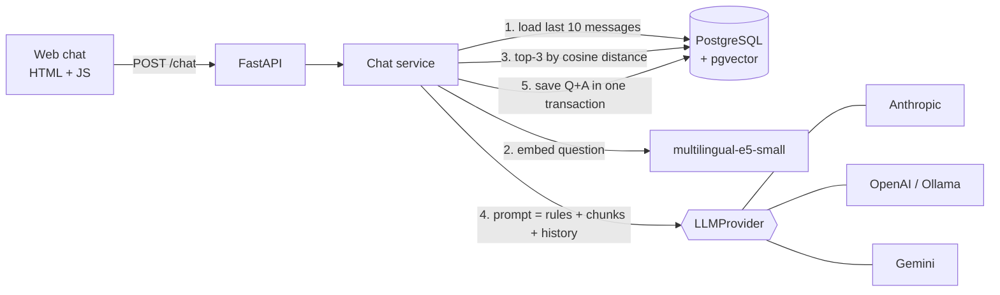

# Hotel FAQ Assistant

A multilingual chatbot that answers hotel guests' questions (check-in, breakfast, parking, …)
from the hotel's own knowledge base, using **Retrieval-Augmented Generation (RAG)**.

- Ask in German, English, Russian, … — the knowledge base is German, the answer comes in the guest's language
- Answers only from the knowledge base; says "I don't know, please ask the reception" instead of inventing facts
- Remembers the conversation, so follow-ups like *"And on weekends?"* work
- Shows which knowledge-base entries an answer was based on
- LLM provider is swappable via `.env`: **Claude, OpenAI, Gemini, or a local model (Ollama)**

## Architecture



**Ingestion** (`python -m app.rag.ingest`): `data/knowledge_base.json` → embeddings → `knowledge_chunks` table.

| Path | Responsibility |
|---|---|
| `app/main.py` | HTTP layer only: endpoints, status codes, static files |
| `app/schemas.py` | API request/response models (separate from DB models) |
| `app/chat/service.py` | Chat logic: history, retrieval, prompt, saving — no HTTP inside |
| `app/chat/models.py` | `conversations`, `messages` tables |
| `app/rag/` | Embeddings, ingestion, vector search |
| `app/llm/` | `LLMProvider` interface + Anthropic / OpenAI-compatible implementations + factory |
| `app/static/` | Chat UI (no framework, no build step) |
| `tests/` | API + factory tests against a separate test DB with a fake LLM |

## Tech stack

Python 3.13 · FastAPI · SQLAlchemy 2 (async) + asyncpg · PostgreSQL 16 + pgvector ·
sentence-transformers (`intfloat/multilingual-e5-small`, 384-dim) · Anthropic / OpenAI SDKs ·
pytest · Docker · uv

## Quick start (Docker)

```bash
cp .env.example .env        # then set POSTGRES_PASS and API_KEY
docker compose up --build
```

Open http://localhost:8080. The container loads the knowledge base on startup.

## Local development

```bash
uv sync
docker compose up -d db                 # only the database
uv run python -m app.rag.ingest         # load the knowledge base
uv run fastapi dev app/main.py          # http://127.0.0.1:8000, API docs at /docs
```

Check the LLM configuration with one real request: `uv run python -m app.llm`

## Configuration

| Variable | Description |
|---|---|
| `POSTGRES_*` | Database connection |
| `LLM_PROVIDER` | `anthropic`, `openai` or `gemini` |
| `LLM_MODEL` | Model id. Default for `anthropic`: `claude-opus-5-5`; required for the others |
| `LLM_BASE_URL` | OpenAI-compatible server, e.g. Ollama: `http://localhost:11434/v1` |
| `API_KEY` | Provider API key (not needed for Ollama) |
| `DB_ECHO` | `true` logs every SQL query |

Examples: Gemini — `LLM_PROVIDER=gemini`, `LLM_MODEL=gemini-2.5-flash` ·
Ollama — `LLM_PROVIDER=openai`, `LLM_MODEL=llama3.2`, `LLM_BASE_URL=http://localhost:11434/v1`

## API

| Method | Path | Description |
|---|---|---|
| `POST` | `/chat` | `{"message": "...", "conversation_id": null}` → answer, `conversation_id`, sources |
| `GET` | `/conversations/{id}/messages` | Conversation history |
| `POST` | `/search` | Vector search only, no LLM — for debugging retrieval |
| `GET` | `/health` | Liveness check |
| `GET` | `/` | Chat UI |

Errors: `404` unknown conversation · `422` invalid input · `502` LLM provider failed.

## Tests

```bash
docker compose up -d db
uv run pytest
```

Tests run against a separate `hotel_db_test` database and replace the LLM with a fake
(via FastAPI `dependency_overrides`), so they are free, fast, offline-safe and deterministic.
They cover retrieval quality (incl. cross-language), follow-up handling, history, validation,
and that a failed LLM call returns `502` and leaves no half-written exchange in the history.

## Design decisions

- **E5 prefixes and normalized vectors.** E5 models expect `query:` / `passage:` prefixes;
  normalized vectors make cosine similarity a simple dot product.
- **Follow-up retrieval.** "And on weekends?" alone retrieves nothing useful, so the previous user
  question is prepended to the search query.
- **No similarity threshold.** E5 scores sit in a narrow ~0.75–0.9 band, so a cutoff can't separate
  relevant from irrelevant. Instead the prompt instructs the model to say "I don't know" when the
  retrieved entries don't contain the answer.
- **Provider as a `Protocol`.** Adding a provider = one class + one line in the factory; the chat
  service never changes. Gemini needed zero new classes thanks to its OpenAI-compatible endpoint.
- **Atomic history.** Question and answer are saved in one transaction after the LLM succeeds.
- **UUID conversation ids.** They are exposed to the browser and must not be guessable.
- **XSS-safe UI.** User and LLM text is rendered with `textContent`, never `innerHTML`.
- **Docker image.** CPU-only PyTorch (no multi-GB CUDA libs), dependencies in a cached layer,
  embedding model baked in, non-root user.

## Limitations and next steps

- Schema is created with `create_all`; production would use **Alembic** migrations.
- No auth or rate limiting on `/chat` — required before exposing it publicly.
- Answers are returned in one piece; **streaming** (SSE) would make long answers feel faster.
- Prompt quality is checked by hand; an **eval set** of question → expected-fact pairs would catch
  regressions when the prompt or model changes.
- For a large knowledge base: chunking of long documents, an HNSW index, hybrid (keyword + vector) search.
